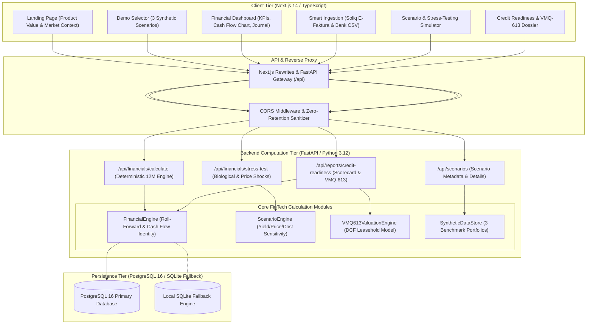

# AgroHisob CFO — System Architecture & Engineering Blueprint

## 1. Executive Summary & Strategic Context

**AgroHisob CFO** is an AgriFinTech B2B SaaS platform engineered specifically for agricultural enterprises in Uzbekistan—including 91,775+ commercial farmers, 633 agro-industrial clusters, 34,283 agro-SMEs, and 4,000+ horticulture exporters (*Stat.uz & AgFin Atlas, 2026*).

### The Systemic Agrobusiness Financial Dilemma:
1. **The Cash-Flow Disconnect**: Traditional farm accounting (1C or Soliq.uz) records only historical tax liabilities. It lacks forward-looking cash flow projections linked to biological crop calendars. In recent years, 19 major textile/cotton clusters suffered severe financial distress and bankruptcy due to unmanaged seasonal cash-flow gaps.
2. **The Collateral Bottleneck**: According to Agrobank's Investor Presentation, 57% of agricultural loan collateral is tied up in urban real estate. Despite Cabinet of Ministers Resolution No. 613 (VMQ-613, Sept 30, 2025) legalizing the pledge of agricultural land lease rights, commercial banks lack automated software to compute the discounted cash flow (DCF) market value of land lease rights.
3. **The Pre-Underwriting Funnel**: While Agrobank operates automated retail micro-loan scoring pipelines, corporate and agro-SME loans ($50k to $5M) require manual dossier preparation taking 3–6 weeks and costing businesses $500–$3,000 in third-party consulting fees.

**AgroHisob CFO** provides an institutional B2B intelligence layer: in under 3 minutes, it ingests Soliq E-faktura and bank statements, reconstructs 12-month seasonal cash flows, calculates Debt Service Coverage Ratios (DSCR), estimates VMQ-613 land lease collateral values, and compiles a bank-grade Credit Readiness Dossier.

---

## 2. Tiered System Architecture

---

## 3. Financial Calculation Core (Mathematical Invariants)

The financial calculations in `backend/app/services/financial_engine.py` are strictly deterministic.

### 3.1 Monthly Cash Flow Identity
For any fiscal period $t \in [1, 12]$:
$$\text{Opening Balance}_t = \begin{cases} \text{Initial Balance}, & t = 1 \\ \text{Closing Balance}_{t-1}, & t > 1 \end{cases}$$

$$\text{Net Cash Flow}_t = \sum \text{Inflows}_t - \sum \text{Outflows}_t$$

$$\text{Closing Balance}_t = \text{Opening Balance}_t + \text{Net Cash Flow}_t$$

**Invariant**: At all times, the system asserts:
$$\text{Final Closing Balance} \equiv \text{Initial Opening Balance} + \sum_{t=1}^{12} \text{Inflows}_t - \sum_{t=1}^{12} \text{Outflows}_t$$

### 3.2 Debt Service Coverage Ratio (DSCR)
The DSCR measures the ability of operating earnings to cover existing debt obligations (principal and interest):

$$\text{Net Operating Cash Flow}_t = \sum \text{Operating Inflows}_t - \sum \text{Operating Outflows (Excluding Debt)}_t$$

$$\text{Monthly DSCR}_t = \frac{\text{Net Operating Cash Flow}_t}{\text{Debt Service}_t}$$

$$\text{Annual DSCR} = \frac{\sum_{t=1}^{12} \text{Net Operating Cash Flow}_t}{\sum_{t=1}^{12} \text{Debt Service}_t}$$

#### Banking Underwriting Thresholds (Uzbekistan Context):
* **DSCR $\ge 1.60\text{x}$**: Excellent (*A'lo*). Significant cushion against adverse price and climate shocks.
* **$1.25\text{x} \le \text{DSCR} < 1.60\text{x}$**: Healthy / Bankable (*Barqaror*). Meets commercial underwriting criteria.
* **$1.00\text{x} \le \text{DSCR} < 1.25\text{x}$**: Watchlist (*Kuzatuv ostida*). Vulnerable to working capital delays.
* **DSCR $< 1.00\text{x}$**: Critical (*Defolt Xatari*). Operating cash flow cannot service outstanding debt.

### 3.3 Liquidity Deficit (Cash-Flow Gap) Detection
A month is flagged as in **Deficit** if:
$$\text{Closing Balance}_t < 0 \quad \text{or} \quad \text{Closing Balance}_t < \text{Safety Buffer}$$

---

## 4. Cabinet of Ministers Resolution No. 613 (VMQ-613) DCF Model

Resolution No. 613 allows agricultural enterprises to use land lease rights (*yer uchastkasiga bo‘lgan ijara huquqi*) as bank loan collateral. AgroHisob CFO incorporates an automated valuation engine based on the Discounted Cash Flow (DCF) of net agricultural renta:

1. **Bonitet Normalization**:
   $$\text{Bonitet Factor} = \frac{\text{Soil Bonitet Score}}{65.0}$$
2. **Annual Net Renta Estimation**:
   $$\text{Adjusted Annual Renta} = \text{Normative Income/ha} \times \text{Bonitet Factor} \times \text{Hectares}$$
3. **Discounted Present Value (DCF)**:
   $$\text{PV} = \text{Adjusted Annual Renta} \times \left[ \frac{1 - (1 + r)^{-n}}{r} \right]$$
   Where $r = 16.0\%$ (cost of capital / discount rate), $n = 25$ years (remaining lease duration).
4. **Bankable Collateral Value**:
   $$\text{Bankable Collateral} = \text{PV} \times 0.65 \quad (\text{65\% regulatory LTV haircut})$$

---

## 5. Synthetic Demo Scenarios (Benchmark Integrity)

The application ships with 3 distinct, internally consistent synthetic scenarios:

| Scenario | Entity Name | Size | Main Crops | Opening Cash | Debt Service | Seasonal Dynamic |
| :--- | :--- | :--- | :--- | :--- | :--- | :--- |
| **Small Farmer** | *Andijon Baraka Fermer Xo'jaligi* | 65 ha | Cotton & Vegetables | 45,000,000 UZS | 12,000,000 UZS/mo (14% Agro loan) | Spring deficit (April/May) due to seeds/fertilizers/fuel; Autumn harvest surplus. |
| **Exporter** | *«Samarqand Agro Eksport» MChJ* | 120 ha | Table Grapes & Cherries | 320,000,000 UZS | 45,000,000 UZS/mo (23.5% loan) | Year-round cold storage OPEX; Export surges in June and August-October. |
| **Cluster** | *«Qashqadaryo Paxta-G'alla Klasteri»* | 2,500 ha | Cotton & Wheat | 1,850,000,000 UZS | 280,000,000 UZS/mo (Syndicate) | Large-scale advance payments to farmers; Massive June (grain) & Oct-Nov (cotton) cash inflows. |

---

## 6. Security, Data Privacy & Regulatory Compliance

1. **Law O‘RQ-547 Compliance**: All enterprise and user records adhere to Uzbekistan's personal and financial data protection regulations.
2. **Zero-Retention Mode**: The platform provides a selectable Zero-Retention Mode where primary document files (Excel E-faktura, CSV bank records) are parsed exclusively in volatile memory (RAM) and immediately purged post-calculation.
3. **No External LLM Leakage**: In compliance with the project constraints, no customer financial figures, STIR numbers, or ledger line-items are transmitted to external third-party LLM APIs.
4. **Explainable AI (XAI)**: Scoring cards and credit readiness metrics are transparent and formula-driven, enabling bank loan officers to inspect each individual component.
