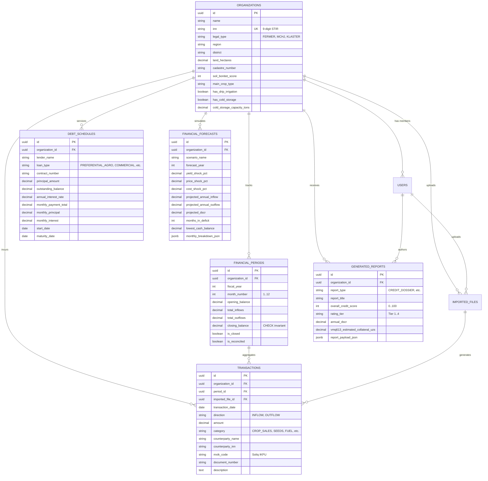

# AgroHisob CFO — Database Architecture & Relational Schema

## 1. Overview & Architectural Principles

AgroHisob CFO is designed as an institutional-grade B2B AgriFinTech SaaS platform for agricultural enterprises in Uzbekistan. The database architecture is built for **PostgreSQL 16** with strong financial consistency, double-entry auditability, and regulatory compliance with the Republic of Uzbekistan legislation (Law O‘RQ-547 "On Personal Data" and Cabinet of Ministers Resolution No. 613 on agricultural land leasehold pledging).

### Core Design Rules:
1. **Mathematical Invariant Verification**: Monthly closing balances are constrained by mathematical identity:
   $$\text{Closing Balance}_t = \text{Opening Balance}_t + \text{Inflows}_t - \text{Outflows}_t$$
2. **Roll-Forward Continuity**: Period $t+1$'s opening balance strictly inherits period $t$'s closing balance.
3. **Primary Document Auditability**: Every transaction is mapped to its primary document source (Soliq E-faktura serial number, Bank statement transaction reference, or cadastral record).
4. **Resilient Local Fallback**: The backend codebase utilizes an adaptive database layer: it connects to PostgreSQL when deployed with Docker/production, and automatically switches to a local SQLite engine during standalone developer testing.

---

## 2. Entity Relationship Diagram (ERD)



---

## 3. Data Dictionary & Entity Definitions

### 3.1 `organizations`
Represents an agribusiness entity operating in the Republic of Uzbekistan.
* `id` (UUID, Primary Key): Unique platform identifier.
* `name` (VARCHAR 255): Legal trade name (e.g. *«Samarqand Agro Eksport» MChJ*).
* `inn` (VARCHAR 9, Unique, Indexed): 9-digit Uzbekistan Taxpayer Identification Number (*STIR*). Validated with exact length.
* `legal_type` (ENUM): Structure classification: `FERMER_XOJALIGI`, `MCHJ`, `AGRO_KLASTER`, `DEHQON_XOJALIGI`, `XK`.
* `region` (VARCHAR 100): Administrative province (e.g. *Andijon viloyati*, *Samarqand viloyati*).
* `district` (VARCHAR 100): Administrative rayon (e.g. *Asaka tumani*, *Urgut tumani*).
* `land_hectares` (NUMERIC 10,2): Total cultivated land area (Must be > 0).
* `cadastre_number` (VARCHAR 50): Unified State Cadastre code (e.g. `17:03:010203:0492`).
* `soil_bonitet_score` (INT): Official soil fertility rating on 1–100 scale (used in VMQ-613 DCF valuation).
* `main_crop_type` (VARCHAR 100): Dominant agricultural produce.
* `has_drip_irrigation` (BOOLEAN): Water-saving equipment presence (PQ-47 subsidy eligibility).
* `has_cold_storage` (BOOLEAN): Refrigerated warehouse presence.
* `cold_storage_capacity_tons` (NUMERIC 10,2): Storage capacity in metric tons.

### 3.2 `financial_periods`
Monthly accounting partitions ensuring full calendar year reconciliation.
* `id` (UUID, Primary Key)
* `organization_id` (UUID, Foreign Key)
* `fiscal_year` (INT): Accounting year (e.g. 2026).
* `month_number` (INT): Calendar month index (1 = Yanvar ... 12 = Dekabr).
* `opening_balance` (NUMERIC 18,2): Cash balance at month start in UZS.
* `total_inflows` (NUMERIC 18,2): Cumulative monthly receipts.
* `total_outflows` (NUMERIC 18,2): Cumulative monthly disbursements.
* `closing_balance` (NUMERIC 18,2): Cash balance at month end in UZS.
* **Integrity Constraint**: `CHECK (closing_balance = opening_balance + total_inflows - total_outflows)`.

### 3.3 `transactions`
Granular line-item financial records extracted from Soliq E-faktura and bank statements.
* `id` (UUID, Primary Key)
* `organization_id` (UUID, Foreign Key)
* `period_id` (UUID, Foreign Key)
* `imported_file_id` (UUID, Foreign Key, Nullable)
* `transaction_date` (DATE)
* `direction` (ENUM): `INFLOW` (Kirim) or `OUTFLOW` (Chiqim).
* `amount` (NUMERIC 18,2): Transaction value in UZS (Must be > 0).
* `category` (ENUM): Agronomic classification (`CROP_SALES`, `EXPORT_PROCEEDS`, `STATE_SUBSIDY`, `SEEDS_PLANTING`, `FERTILIZER_CHEMICALS`, `FUEL_LUBRICANTS`, `LABOR_SALARIES`, `MACHINERY_LEASING`, `UTILITIES_WATER_TAX`, `DEBT_SERVICE_PRINCIPAL`, `DEBT_SERVICE_INTEREST`, `COLD_STORAGE_OPEX`, `TAXES_OTHER`, `MISC_EXPENSES`).
* `counterparty_name` (VARCHAR 255): Supplier or buyer organization name.
* `counterparty_inn` (VARCHAR 9): Buyer/Seller STIR.
* `mxik_code` (VARCHAR 20): Soliq Unified Product & Service Classification Code (*IKPU / MXIK*).
* `document_number` (VARCHAR 100): Electronic invoice or payment order number.

### 3.4 `debt_schedules`
Contractual debt amortization schedules from commercial and state banks.
* `id` (UUID, Primary Key)
* `organization_id` (UUID, Foreign Key)
* `lender_name` (VARCHAR 150): Lending institution (e.g. *ATB «Agrobank»*).
* `loan_type` (ENUM): `PREFERENTIAL_STATE_AGRO`, `COMMERCIAL_WORKING_CAPITAL`, `EQUIPMENT_LEASING`, `COLD_STORAGE_CAPEX`.
* `contract_number` (VARCHAR 100)
* `principal_amount` (NUMERIC 18,2)
* `outstanding_balance` (NUMERIC 18,2)
* `annual_interest_rate` (NUMERIC 5,2): Contract percentage (e.g. 14.00% or 23.50%).
* `monthly_payment_total` (NUMERIC 18,2)
* `start_date` / `maturity_date` (DATE)

### 3.5 `financial_forecasts`
Simulation results generated by the sensitivity and stress-testing engine.
* `yield_shock_pct` (NUMERIC 5,2): Harvest yield shock (-50% to +50%).
* `price_shock_pct` (NUMERIC 5,2): Market price fluctuation (-50% to +50%).
* `cost_shock_pct` (NUMERIC 5,2): Input inflation (+0% to +50%).
* `projected_dscr` (NUMERIC 6,3): Stressed Debt Service Coverage Ratio.
* `months_in_deficit` (INT): Number of months where closing cash is negative.
* `monthly_breakdown_json` (JSONB): Complete month-by-month cash trajectory under stress.

### 3.6 `generated_reports`
Archived credit readiness dossiers ready for bank committee evaluation.
* `report_type` (ENUM): `CREDIT_DOSSIER_SUMMARY`, `CASH_FLOW_12M_AUDIT`, `VMQ613_LEASEHOLD_VALUATION`.
* `overall_credit_score` (INT): Heuristic score (0–100).
* `rating_tier` (VARCHAR 10): Letter rating (`Tier 1 (A)`, `Tier 2 (B)`, etc.).
* `annual_dscr` (NUMERIC 6,3): Historical or forecast coverage ratio.
* `vmq613_estimated_collateral_uzs` (NUMERIC 18,2): Bankable collateral value under 65% LTV.
* `report_payload_json` (JSONB): Full serialized dossier report.

---

## 4. DDL Execution & Migrations

The full PostgreSQL DDL schema is maintained in `backend/app/db/schema.sql`.
To instantiate the schema on a fresh PostgreSQL instance:
```bash
psql -U agrohisob -d agrohisob_db -f backend/app/db/schema.sql
```
For local developer testing without Docker, the SQLAlchemy layer in `backend/app/db/database.py` seamlessly creates matching tables inside `agrohisob_local.db`.
