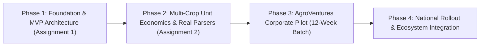

# AgroHisob CFO — Product Development Roadmap

## Strategic Vision

AgroHisob CFO is positioned as the definitive **Pre-Underwriting & Financial Intelligence Operating System** for Uzbekistan’s agribusiness ecosystem, serving agricultural producers, processing clusters, and institutional lenders (Agrobank, Ipak Yo'li, Hamkorbank, ADB, IFC).

---

## Roadmap Phases

---

### Phase 1: Foundation & Architecture (Assignment 1 — COMPLETED)

- [x] **Repository & Clean Separation**: Structured Next.js 14 frontend and FastAPI Python backend.
- [x] **Core Relational Data Architecture**: PostgreSQL schema specification with 9 essential entities (Organizations, Users, Periods, Transactions, Files, Debt Schedules, Forecasts, Reports).
- [x] **Deterministic Financial Engine**: Pure Python calculation module guaranteeing double-entry cash flow arithmetic:
  $$\text{Closing Balance}_t = \text{Opening Balance}_t + \text{Inflows}_t - \text{Outflows}_t$$
- [x] **Synthetic Scenario Portfolios**: 3 verified, internally consistent scenarios (Small Farmer, Exporter, Cluster) reflecting Uzbekistan's seasonal dynamics.
- [x] **Product Navigation & 6 Key Views**:
  - Landing Page with agribusiness macroeconomic context
  - Demo Selector with scenario meta cards
  - Financial Dashboard with dynamic KPI cards & Recharts cash-flow visualization
  - Smart Data Import UI with MXIK categorization preview
  - Scenario & Stress-Testing Simulator with interactive shock sliders
  - Credit Readiness Report with DSCR analysis & VMQ-613 leasehold collateral calculation
- [x] **Automated Test Suite**: 14 passing automated tests verifying financial calculations, reconciliation, scenario integrity, and API endpoint validations.
- [x] **Comprehensive Documentation**: Complete `README.md`, `ARCHITECTURE.md`, `DATABASE_SCHEMA.md`, `DEVELOPMENT_ROADMAP.md`, `TESTING_CHECKLIST.md`, `.env.example`, and `docker-compose.yml`.

---

### Phase 2: Advanced Unit Economics & Document Parsing (Assignment 2)

- [ ] **Multi-Crop Agronomic Tech-Card (Texnologik Xarita)**:
  - Embed official Uzbekistan agronomic expenditure benchmarks for 15+ crops (cotton, winter wheat, cherries, table grapes, tomatoes, onions, apples).
  - Compare actual vs planned expenditure per hectare.
- [ ] **Direct E-Faktura (XLSX / XML) Parser**:
  - Full ingestion pipeline for raw Soliq.uz electronic invoice downloads.
  - Automatic fuzzy matching for Uzbekistan 17-digit MXIK (IKPU) codes to assign transactions to standardized cost buckets.
- [ ] **Bank Statement Parser (1C / Text / CSV)**:
  - Regex-based transaction classification for Uzbekistan payment descriptions (*«Назначение платежа»*).
  - Duplicate transaction detection using cryptographic hashing (SHA-256).
- [ ] **Stochastic Monte-Carlo Cash-Flow Simulation**:
  - Run 1,000 randomized iterations of weather and price volatility to compute Value-at-Risk (VaR) and probability of cash deficit.
- [ ] **Exportable Bank Dossier (PDF & XLSX)**:
  - High-fidelity PDF report generation using ReportLab, formatted for commercial bank credit committee review.

---

### Phase 3: AgroVentures Accelerator & Regional Pilot (12-Week Batch)

- [ ] **Field Pilot (Tashkent & Samarkand Regions)**:
  - Pilot onboarding of 25 agribusiness clients (10 horticulture exporters, 2 agro-clusters, 13 commercial farmers from *Fermerlar Maktabi*).
  - Target: Reduce credit dossier preparation time from 14 days to under 30 minutes.
- [ ] **Agrobank Pre-Underwriting API Bridge**:
  - Establish read-only submission channel to Agrobank's SME credit underwriting department (*AgroZamin Biznes*).
  - Target: Accelerate bank credit committee review from 10 days to under 48 hours.
- [ ] **Certified VMQ-613 Leasehold Valuation Partnership**:
  - Partner with licensed valuation appraisal firms to co-sign automated DCF land lease valuation reports.
- [ ] **Dual-Ledger Reconciliation (White-Label)**:
  - Support reconciliation of official tax filings with internal operational management accounts (*boshqaruv hisobi*) within a confidential, encrypted environment.

---

### Phase 4: National Scale & Sustainable Monetization

- [ ] **Tiered B2B SaaS Subscriptions**:
  - *Fermer Pro*: \$29/month (370,000 UZS)
  - *Agro-SME / Exporter*: \$99/month (1,267,000 UZS)
  - *Agro-Cluster Enterprise*: \$249/month (3,187,000 UZS)
- [ ] **Bank Origination & Verification Fee**:
  - 0.25%–0.40% success fee on bank loans funded via pre-verified AgroHisob CFO dossiers.
- [ ] **Supply Chain Finance Integration**:
  - Integration with agro-input distributors (seeds, fertilizers) for seasonal Murabaha / trade-credit terms.
- [ ] **Regional Expansion**:
  - Localize models for neighboring Central Asian markets (Kazakhstan, Kyrgyzstan, Tajikistan).
