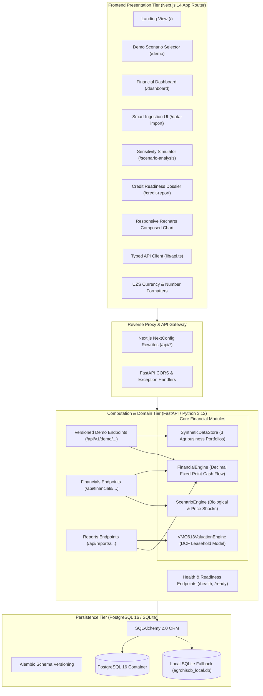

# AgroHisob CFO — System Architecture & Engineering Blueprint

**Document Reference:** `docs/ARCHITECTURE.md`  
**Author:** Principal Software Architect & FinTech Systems Engineer  
**Status:** Approved for Assignment 1 Baseline

---

## 1. Architectural Philosophy & Principles

AgroHisob CFO is designed as an institutional **Modular Monolith** engineered for high-precision AgriFinTech data processing. In financial software, computational transparency and deterministic auditability take precedence over speculative AI models.

### Key Architectural Principles:
1. **Single Source of Truth for Financial Logic**: All financial calculations (opening balance, inflows, outflows, net cash flow, closing balance, DSCR, deficit detection) are executed exclusively within the Python backend financial engine. The frontend never computes or guesses financial totals.
2. **Deterministic, Reproducible Arithmetic**: Computations rely on Python's `Decimal` fixed-point arithmetic. No floating-point rounding errors are permitted. Results are 100% reproducible given identical ledger inputs.
3. **No External LLM Dependencies for Numbers**: In strict accordance with financial system security and project constraints, no customer financial figures, ledger entries, or tax IDs are sent to external LLMs.
4. **Resilient Multi-Database Abstraction**: The data layer connects natively to **PostgreSQL 16** in production and Docker environments, while seamlessly falling back to a local **SQLite 3** engine for zero-friction local developer testing without external infrastructure prerequisites.
5. **Strict Multi-Tenant Isolation**: Organizations and their financial periods are structurally isolated by unique UUID foreign keys.

---

## 2. Multi-Tier System Diagram

---

## 3. Technology Stack Specification

| Tier | Component | Technology Selection | Version | Architectural Justification |
| :--- | :--- | :--- | :--- | :--- |
| **Frontend** | Framework | Next.js (App Router) | 14.2.35 | Server-side rendering, streaming, fast page loads |
| **Frontend** | UI Library | React | 18.3.1 | Battle-tested component lifecycle & stability |
| **Frontend** | Language | TypeScript | 5.6.3 | Compile-time domain type safety |
| **Frontend** | Styling | Tailwind CSS | 3.4.17 | Utility-first design tokens, zero runtime overhead |
| **Frontend** | Visualization | Recharts | 3.10.1 | Responsive SVG charting for multi-series cash flow |
| **Frontend** | Icons | Lucide React | 1.70.0 | Lightweight, modern icon set |
| **Backend** | Framework | FastAPI | 0.162.2 | High async throughput, auto OpenAPI documentation |
| **Backend** | Runtime | Python | 3.12.14 | Modern typing, high-performance runtime |
| **Backend** | Validation | Pydantic v2 | 2.14.2 | Strict schema serialization and input sanitization |
| **Backend** | ORM | SQLAlchemy | 2.1.8 | Type-safe declarative database mapping |
| **Backend** | Migrations | Alembic | 1.20.1 | Reproducible database schema migrations |
| **Backend** | Financial Math | Python `Decimal` | Built-in | Exact 28-digit fixed-point currency arithmetic |
| **Backend** | Tabular/Numerics | Pandas & NumPy | 2.2+ / 2.0+ | Vectorized operations for future large E-faktura batches |
| **Backend** | Test Harness | Pytest & HTTPX | 9.2.0 / 0.28+ | Automated test execution with mock client |
| **Database** | Primary RDBMS | PostgreSQL | 16-alpine | ACID compliance, JSONB support, check constraints |
| **Database** | Fallback RDBMS | SQLite 3 | Built-in | Standalone local developer velocity without Docker |

---

## 4. Separation of Responsibilities

### 4.1 Frontend Layer Responsibilities
* Presenting clean financial information hierarchy.
* Providing loading skeletons and responsive user feedback.
* Handling user interaction (switching demo businesses, moving stress-test sliders).
* Dispatching typed REST requests to the backend gateway.
* Rendering financial charts based on exact backend response numbers.
* Zero financial calculation logic in React components.

### 4.2 Backend Layer Responsibilities
* Request payload validation and error generation using RFC 7807 problem details.
* Managing organization isolation and tenant boundaries.
* Executing the deterministic 12-month cash flow roll-forward.
* Enforcing business invariants (positive amounts, valid dates, allowable shock bounds).
* Generating structured JSON responses with explicit audit reconciliation messages.

### 4.3 Database Layer Responsibilities
* Enforcing relational integrity via foreign keys and cascade rules.
* Guaranteeing double-entry equality via table-level check constraints (`chk_closing_balance_identity`).
* Indexing critical lookup columns (`inn`, `organization_id`, `transaction_date`).
* Maintaining historical audit logs for imported files and generated credit reports.

---

## 5. Financial Calculation Core Invariants

### 5.1 Cash Flow Invariant
For month $t \in [1, 12]$:
$$\text{Opening Balance}_t = \begin{cases} \text{Initial Balance}, & t = 1 \\ \text{Closing Balance}_{t-1}, & t > 1 \end{cases}$$
$$\text{Net Cash Flow}_t = \text{Total Inflows}_t - \text{Total Outflows}_t$$
$$\text{Closing Balance}_t = \text{Opening Balance}_t + \text{Net Cash Flow}_t$$

### 5.2 Decimal Implementation
All monetary calculations in `financial_engine.py` convert inputs to `Decimal` objects and quantize outputs to `Decimal('0.01')` using standard commercial rounding (`ROUND_HALF_UP`).

### 5.3 Debt Service Coverage Ratio (DSCR)
$$\text{Annual DSCR} = \frac{\sum_{t=1}^{12} (\text{Inflows}_t - \text{Operating Outflows}_t)}{\sum_{t=1}^{12} \text{Debt Service}_t}$$

### 5.4 VMQ-613 Leasehold Land Collateral DCF Model
$$\text{Present Value (DCF)} = \left[ \text{Base Renta/ha} \times \left( \frac{\text{Bonitet}}{65} \right) \times \text{Hectares} \right] \times \left[ \frac{1 - (1 + r)^{-n}}{r} \right]$$
$$\text{Bankable Collateral} = \text{Present Value} \times 0.65 \quad (\text{65\% regulatory LTV haircut})$$
Where $r = 16.0\%$ discount rate, $n = 25$ years remaining lease term.
