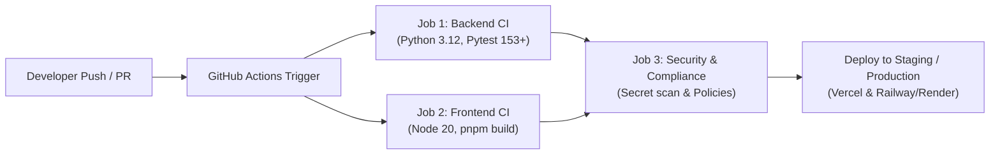

# AGROHISOB CFO — CI/CD AVTOMATLASHTIRILGAN ISH OQIMI VA QUVR ARXITEKTURASI

**Hujjat identifikatori:** `DOC-AH-CICD-01`  
**Sana:** 2026-11-09  
**Holat:** TASDIQLANGAN (APPROVED)  

---

## 1. CI/CD QUVRINING MAQSADI VA TUZILISHI

AgroHisob CFO platformasining uzluksiz integratsiyasi va yetkazib berilishi (Continuous Integration & Continuous Delivery - CI/CD) GitHub Actions vositasida to'liq avtomatlashtirilgan. Quvrning asosiy maqsadi — har bir o'zgarishda moliyaviy hisob-kitoblar aniqligini, xavfsizlik talablarini va ishlab chiqarish build barqarorligini inson omilisiz tekshirishdir.



---

## 2. BOSQICHMA-BOSQICH JOB LAR TAVSIFI

### 1-Job: `backend-ci` (Backend tekshiruvlari va Moliyaviy Regressiya)
- **Operatsion tizim:** `ubuntu-latest`
- **Muhit:** Python 3.12 (pip kesh bilan optimallashtirilgan)
- **Vazifalar:**
  1. `backend/requirements.txt` dagi barcha bog'liqliklarni o'rnatish.
  2. Asosiy Python fayllarini sintaksis tekshiruvidan o'tkazish (`py_compile`).
  3. Barcha 153+ ta avtomatlashtirilgan testlarni izolyatsiyalangan xotira SQLite bazasida to'liq bajarish.
  4. Moliyaviy formulalar (Cash Flow ayniyati, DSCR, DCF diskontlash, PQ-47 va PF-82 qoidalari) yaxlitligini tasdiqlash.

### 2-Job: `frontend-ci` (Frontend integratsiyasi va Next.js Production Build)
- **Operatsion tizim:** `ubuntu-latest`
- **Muhit:** Node.js 20.x, Corepack, pnpm
- **Vazifalar:**
  1. Frontend paketlarini o'rnatish (`pnpm install`).
  2. TypeScript statik turlarini to'liq tekshirish (`tsc --noEmit`).
  3. Next.js 14 App Router production bundle yig'ish (`pnpm run build`).
  4. Server-Side Rendering (SSR) va Statik sahifalar (SSG) renderlanishini tekshirish.

### 3-Job: `security-and-compliance` (Xavfsizlik va Maxfiylik Nazorati)
- **Bog'liqligi:** Faqatgina `backend-ci` va `frontend-ci` muvaffaqiyatli yakunlangach ishga tushadi.
- **Vazifalar:**
  1. Repozitoriyda tasodifan qolib ketgan parollar, Supabase ulanish satrlari yoki shaxsiy kalitlarni avtomatik skanerlash.
  2. Reliz tayyorgarligi tamg'asini qo'yish.

---

## 3. LOKAL SHAROITDA CI/CD TEKSHIRUVLARINI ISHGA TUSHIRISH

Dasturchilar kodni Git ga yuborishdan oldin mahalliy terminalda xuddi CI/CD quvridagi kabi tekshiruvlarni amalga oshirishlari mumkin:

```powershell
# 1. Backend testlarini to'liq ishga tushirish
python -m pytest backend/tests -v

# 2. Frontend buildini sinovdan o'tkazish
cd frontend
pnpm run build
cd ..
```
