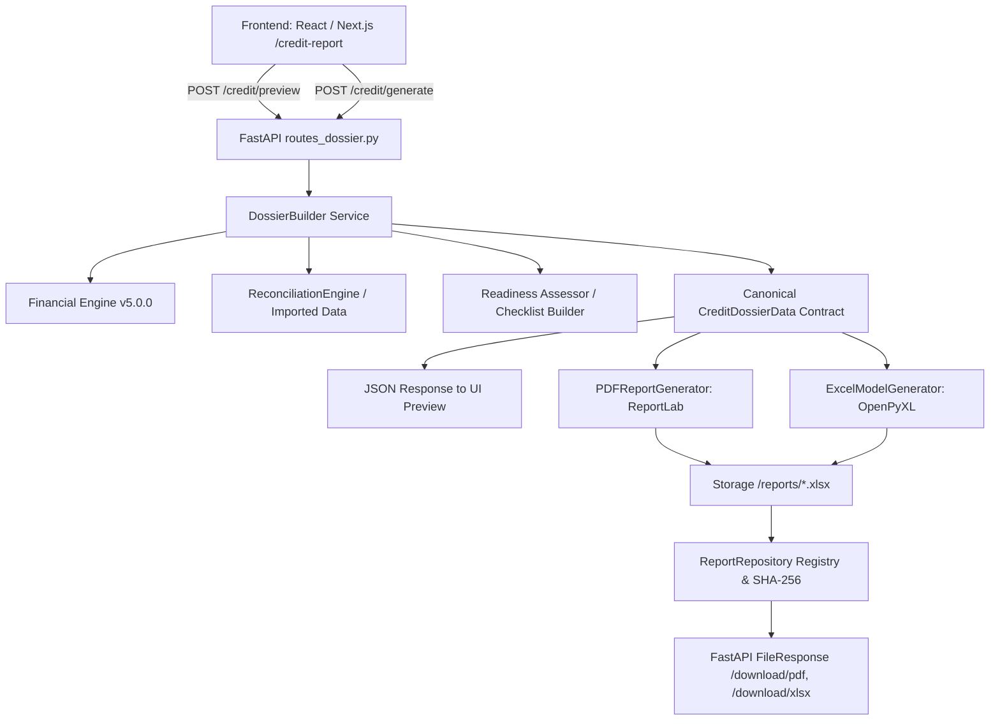

# AGROHISOB CFO — KREDIT DOSYESI ARXITEKTURASI (ASSIGNMENT 5)

## 1. Umumiy Arxitektura Modeli
AgroHisob CFO 5-topshiriq doirasida mustahkam, kanonik va qat'iy modulli hisobot generatsiya infratuzilmasi joriy etildi.

---

## 2. Kanonik Ma'lumotlar Modeli (Single Source of Truth)
Hech qanday hisobot (PDF yoki Excel) mustaqil hisob-kitob bajarmaydi. Barcha raqamlar `CreditDossierData` kanonik ob'ekti orqali ta'minlanadi:
1. `credit_profile`: Arizachi profili, so'ralayotgan kredit summasi, muddati, foizi, maqsadi.
2. `checklist`: 5 ta domendagi hujjatlar ro'yxati, mavjudlik holati va to'liqlik foizi.
3. `readiness_assessment`: 0-100 ball reyting, kuchli tomonlar, xatarlar, cheklovlar.
4. `historical_summary`: 12 oylik haqiqiy kassa oqimlari, toifalar kesimi.
5. `forecast_summary`: 12 oylik mavsumiy kassa prognozi, kassa uzilishi (gap) oylari, CFADS.
6. `debt_dscr_summary`: Amortizatsiya grafigi, mavjud va yangi qarz xizmati, birlashtirilgan DSCR.
7. `risks_scenarios_summary`: Bazaviy, optimistik va pessimistik stress tahlili natijalari.
8. `data_sources_and_assumptions`: Ma'lumot manbasi (Bank ko'chirmasi yoki Sintetik benchmark), valyuta, dvigatel versiyasi.
9. `regulatory_disclaimer_uz`: Rasmiy huquqiy ogohlantirish matni.

---

## 3. Komponentlar Mas'uliyati
- `app.reporting.report_schemas`: Pydantic V2 modellar majmuasi.
- `app.reporting.credit_profile`: Profil validatsiyasi va korxona turlari bo'yicha standart sozlamalar.
- `app.reporting.readiness_assessment`: Deterministik anderrayting reytingi va nazorat ro'yxati shakllantiruvchisi.
- `app.reporting.dossier_builder`: Moliyaviy dvigatel, rekonsiliatsiya va ssenariylarni birlashtiruvchi kanonik dosye tuzuvchi.
- `app.reporting.pdf_generator`: ReportLab 4.4.9 kutubxonasiga asoslangan 8 bo'limli, ikki bosqichli `NumberedCanvas` (Sahifa X / Y) ga ega A4 formatdagi PDF generator.
- `app.reporting.excel_generator`: OpenPyXL 3.1.5 asosidagi 8 varaqli, muzlatilgan sarlavhali, UZS raqam formatli va formula in'eksiyasidan himoyalangan moliyaviy model.
- `app.reporting.report_repository`: Fayllarni diskda saqlash, SHA-256 xeshlarini yuritish va metadata boshqaruvi.
- `app.api.routes_dossier`: Versiyalangan REST API marshrutlari.
- `frontend/src/app/credit-report/page.tsx`: Foydalanuvchining interaktiv tahliliy kabineti.
