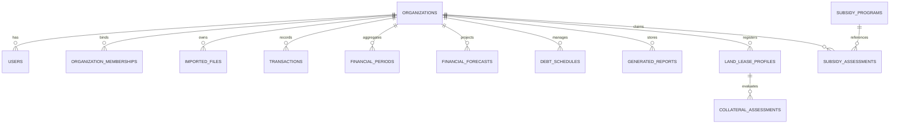

# AGROHISOB CFO — POSTGRESQL / SUPABASE MA'LUMOTLAR BAZASI STRATEGIYASI VA REJASI (DATABASE DEPLOYMENT PLAN)

**Hujjat identifikatori:** `DOC-AH-DB-01`  
**Sana:** 2026-11-09  
**Holat:** TASDIQLANGAN (APPROVED)  
**Tadqiqotchi guruh:** PostgreSQL Database Architect, Cloud DB Engineer  

---

## 1. MA'LUMOTLAR BAZASI ARXITEKTURASI VA XIZMATLAR

AgroHisob CFO korxona darajasidagi relyatsion ma'lumotlar tuzilmasiga ega bo'lib, quyidagi 13 ta asosiy SQLAlchemy jadvallaridan iborat:

---

## 2. 13 TA ASOSIY JADVAL RO'YXATI VA VAZIFALARI

1. `organizations` — Agrobiznes subyektlari (Fermer xo'jaliklari, MCHJ, klasterlar). STIR/INN, OPI/OPF, viloyat va tuman ma'lumotlari.
2. `users` — Tizim foydalanuvchilari (CFO, buxgalter, agronom, bank tahlilchisi).
3. `organization_memberships` — Foydalanuvchilarning tashkilotlarga bo'lgan ko'pdan-ko'pga rollari (RBAC).
4. `imported_files` — Yuklangan 1C/Bank/E-faktura fayllari reestri, SHA-256 xesh, qatorlar soni, holati.
5. `transactions` — Bank va buxgalteriya tranzaksiyalari (kirim, chiqim, sanasi, kontragent, operatsion/shaxsiy ajratish).
6. `financial_periods` — Oylik va choraklik agregatsiyalangan moliyaviy ko'rsatkichlar (Kirim, Chiqim, Net kassa oqimi).
7. `financial_forecasts` — 12 oylik mavsumiy kassa prognozlari va ekin marjinalligi.
8. `debt_schedules` — Bank kreditlari amortizatsiya jadvallari, oylik asosiy qarz va foiz to'lovlari.
9. `generated_reports` — Generatsiya qilingan rasmiy Kredit Tayyorgarligi Dosyelari (PDF va Excel metadata va xeshlar).
10. `land_lease_profiles` — VMQ-613 bo'yicha qishloq xo'jaligi yer ijarasi profillari (kadastr raqami, gektar, bonitet balli, ijara muddati).
11. `collateral_assessments` — Chekli muddatli DCF indikativ baholash natijalari va sezgirlik tahlili.
12. `subsidy_programs` — O'zbekiston Respublikasi davlat qishloq xo'jaligi subsidiya dasturlari reestri (PQ-47, PF-82 va boshqalar).
13. `subsidy_assessments` — Fermer xo'jaliklarining subsidiyalarga bo'lgan muvofiqlik arizalari va hisoblangan kompensatsiya summalari.

---

## 3. INDEKSLAR VA SO'ROVLAR OPTIMALLASHTIRILISHI

Yuqori unumdorlik va qidiruv tezligini ta'minlash uchun PostgreSQL darajasida quyidagi indekslar tashkil etiladi:

- `CREATE INDEX idx_transactions_org_date ON transactions (organization_id, transaction_date DESC);`
- `CREATE INDEX idx_transactions_category ON transactions (organization_id, category);`
- `CREATE INDEX idx_imported_files_checksum ON imported_files (sha256_checksum);`
- `CREATE INDEX idx_land_lease_cadastre ON land_lease_profiles (cadastre_number);`
- `CREATE INDEX idx_collateral_org_lease ON collateral_assessments (organization_id, land_lease_id);`
- `CREATE INDEX idx_subsidy_assessments_org ON subsidy_assessments (organization_id, program_id);`

---

## 4. SUPABASE GA MIGRATSIYA VA BOSH QADAMLAR

1. **Jadvallarni yaratish:**
   - Dastur ishga tushganda `init_db()` SQLAlchemy orqali avtomatik ravishda barcha jadvallar va xorijiy kalitlarni (Foreign Keys with CASCADE) yaratadi.
2. **Sintetik Boshlang'ich Ma'lumotlarni Joylash (Seed Data):**
   - 3 ta tayyor sintetik korxona (Kichik fermer, Meva eksportchisi, Agromahsulot klasteri) va ularning 12 oylik kassa oqimlari avtomatik initsializatsiya qilinadi.
3. **Ulanish puli (Supavisor):**
   - Supabase Port 6543 (Transaction Pooler) orqali SQLAlchemy `pool_size=10, max_overflow=20` bilan ulanadi, bu esa serverless yoki mikroxizmatlar ko'p bo'lganda ham ulanishlar limitiga yetib bormasligini kafolatlaydi.

---

## 5. ZAXIRA NUSXALASH VA MONITORING

- **Avtomatik zaxira:** Supabase har kuni soat 00:00 UTC da to'liq zaxira nusxalarini oladi.
- **Saqlash muddati:** Bepul tarifda 7 kun, Pro tarifda 30 kunlik Point-in-time recovery (PITR).
- **Favqulodda tiklash:** Falokat yuz berganda so'nggi tranzaksiya holatigacha tiklash imkoniyati kafolatlanadi.
