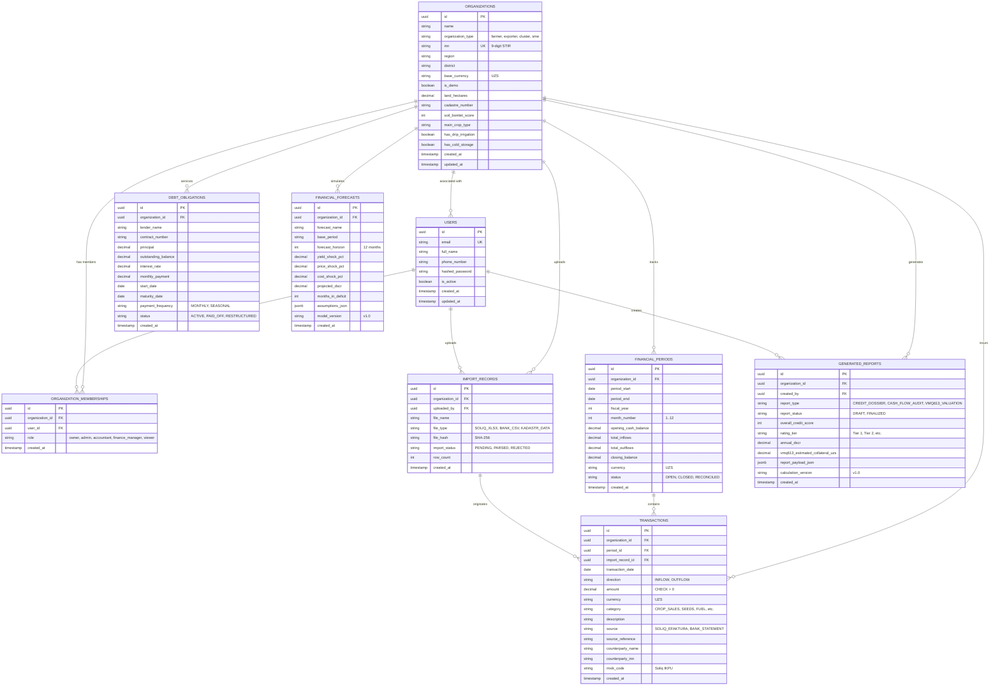

# AgroHisob CFO — Relational Database Architecture

**Document Reference:** `docs/DATABASE_SCHEMA.md`  
**Author:** PostgreSQL Database Architect & Security Engineer  
**Database Engine:** PostgreSQL 16 (with SQLite 3 local fallback)

---

## 1. Architectural Overview

The AgroHisob CFO database schema is designed for multi-tenant B2B financial software. It enforces strict relational integrity, organization-level isolation, and immutable auditability for financial transactions and pre-underwriting reports.

### Structural Tenets:
* **UUID Primary Keys**: Eliminates enumeration vulnerabilities and enables offline ID generation.
* **DECIMAL/NUMERIC for Monetary Types**: All financial values use `NUMERIC(18, 2)` to eliminate floating-point rounding errors.
* **Strict Check Constraints**: Core double-entry identity is verified at the database level:
  `CHECK (closing_balance = opening_balance + total_inflows - total_outflows)`.
* **Explicit Foreign Key Cascades**: Child entities cascade deletion safely, while uploaded files and audit reports use `SET NULL` on user deletion to preserve compliance history.

---

## 2. Entity Relationship Diagram (ERD)



---

## 3. Data Dictionary

### 3.1 `organizations`
Core enterprise tenancy entity.
* `id` (`UUID`, PK): Platform-wide identifier.
* `name` (`VARCHAR(255)`, NOT NULL): Legal company name.
* `organization_type` (`VARCHAR(50)`, NOT NULL): `farmer`, `agricultural_sme`, `exporter`, `agricultural_cluster`.
* `inn` (`VARCHAR(9)`, UNIQUE, NOT NULL): 9-digit Uzbekistan Taxpayer Identification Number (*STIR*).
* `region` / `district` (`VARCHAR(100)`, NOT NULL): Administrative geography.
* `base_currency` (`VARCHAR(3)`, NOT NULL, DEFAULT `'UZS'`): Operating currency.
* `is_demo` (`BOOLEAN`, NOT NULL, DEFAULT `FALSE`): Distinguishes synthetic benchmark businesses from real client tenants.
* `land_hectares` (`NUMERIC(10, 2)`, NOT NULL): Cultivated land area.
* `soil_bonitet_score` (`INTEGER`, CHECK 1..100): Land fertility rating.

### 3.2 `organization_memberships`
Role-Based Access Control (RBAC) linking users to enterprise tenants.
* `id` (`UUID`, PK)
* `organization_id` (`UUID`, FK $\rightarrow$ `organizations.id` ON DELETE CASCADE)
* `user_id` (`UUID`, FK $\rightarrow$ `users.id` ON DELETE CASCADE)
* `role` (`VARCHAR(50)`, NOT NULL): `owner`, `admin`, `accountant`, `finance_manager`, `viewer`.

### 3.3 `transactions`
Granular cash movements.
* `id` (`UUID`, PK)
* `organization_id` (`UUID`, FK $\rightarrow$ `organizations.id` ON DELETE CASCADE)
* `period_id` (`UUID`, FK $\rightarrow$ `financial_periods.id` ON DELETE SET NULL)
* `transaction_date` (`DATE`, NOT NULL)
* `direction` (`VARCHAR(10)`, NOT NULL, CHECK in `('INFLOW', 'OUTFLOW')`)
* `amount` (`NUMERIC(18, 2)`, NOT NULL, CHECK `amount > 0`)
* `category` (`VARCHAR(50)`, NOT NULL): Agronomic category (`CROP_SALES`, `SEEDS_PLANTING`, `FERTILIZER_CHEMICALS`, `FUEL_LUBRICANTS`, `LABOR_SALARIES`, `DEBT_SERVICE`, etc.)
* `source` (`VARCHAR(50)`): `SOLIQ_EFAKTURA`, `BANK_STATEMENT`, `MANUAL_ADJUSTMENT`.
* `mxik_code` (`VARCHAR(20)`): Uzbekistan IKPU product code.

### 3.4 `financial_periods`
Monthly accounting partitions.
* `id` (`UUID`, PK)
* `organization_id` (`UUID`, FK)
* `period_start` / `period_end` (`DATE`, NOT NULL)
* `fiscal_year` (`INTEGER`, NOT NULL)
* `month_number` (`INTEGER`, CHECK 1..12)
* `opening_cash_balance` (`NUMERIC(18, 2)`, NOT NULL)
* `total_inflows` (`NUMERIC(18, 2)`, NOT NULL, DEFAULT 0.00)
* `total_outflows` (`NUMERIC(18, 2)`, NOT NULL, DEFAULT 0.00)
* `closing_balance` (`NUMERIC(18, 2)`, NOT NULL)
* `status` (`VARCHAR(20)`, NOT NULL, DEFAULT `'OPEN'`)
* **Constraint**: `CHECK (closing_balance = opening_cash_balance + total_inflows - total_outflows)`

---

## 4. Multi-Tenancy Security & Data Isolation

1. **Foreign Key Enclosure**: Every table holding financial transactions, debt records, or forecasts explicitly references `organization_id`.
2. **Demo Data Protection**: Demo records carry `is_demo = TRUE`. Public demonstration APIs strictly query datasets where `is_demo = TRUE`, ensuring private enterprise records are never exposed without authorization.
3. **Prepared for Row-Level Security (RLS)**: The PostgreSQL schema is structured for native RLS policies:
   ```sql
   CREATE POLICY tenant_isolation_policy ON transactions
   FOR ALL USING (organization_id = current_setting('app.current_organization_id')::uuid);
   ```
