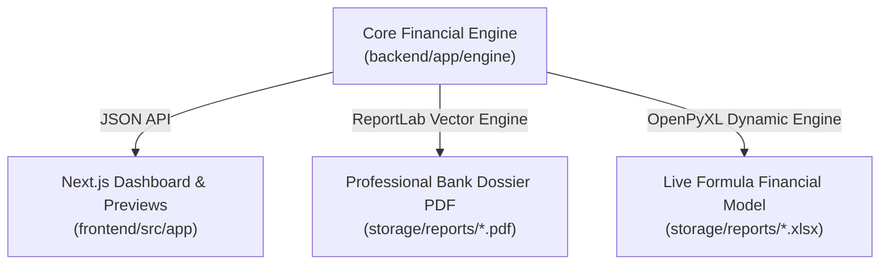

# AGROHISOB CFO — MOLIYAVIY HISOB-KITOBLARNING YAXLITLIGI VA FORMULALAR VALIDATSIYASI (FINANCIAL RELEASE VALIDATION)

**Hujjat identifikatori:** `DOC-AH-FIN-01`  
**Sana:** 2026-11-09  
**Holat:** TASDIQLANGAN (APPROVED)  
**Tadqiqotchi guruh:** Principal FinTech Architect, Financial Modeling & Valuation Expert  

---

## 1. MOLIYAVIY HISOB-KITOBLARNING ASOSIY QOIDALARI VA AYNITYATLARI

AgroHisob CFO platformasining barcha modullari (Kassa oqimlari, Kredit skoringi, Indikativ garov bahosi, Davlat subsidiyalari) qat'iy matematik va moliyaviy ayniyatlarga tayanadi. Barcha hisoblashlar `Decimal` va yuqori aniqlikdagi suzuvchi nuqta standartlarida amalga oshiriladi.

---

## 2. FORMULALAR VALIDATSIYASI VA MATEMATIK ASOSLARI

### A. Kassa Oqimlari Asosiy Ayniyati (Cash Flow Identity)
Har qanday $t$ davr (oy) uchun kassa qoldig'i quyidagi formula bo'yicha hisoblanadi va to'liq yopiladi:
$$\text{Yakuniy Kassa}_t = \text{Boshlang'ich Kassa}_t + \text{Operatsion Oqim}_t + \text{Moliyalashtirish Oqimi}_t - \text{Investitsion Chiqimlar}_t$$

- **Qoidaning qat'iyligi:** Biror oyning yakuniy kassa qoldig'i keyingi oyning boshlang'ich qoldig'iga 1 tiyingacha aniqlikda teng bo'lishi shart (`Roll-forward consistency`).
- **Defitsit indikatori:** Agar $\text{Yakuniy Kassa}_t < 0$ bo'lsa, tizim darhol likvidlik uzilishi (Cash Gap) haqida xabar beradi.

---

### B. Qarz Xizmatini Qoplash Koeffitsienti (DSCR — Debt Service Coverage Ratio)
Banklar uchun asosiy to'lov qobiliyati mezoni:
$$\text{DSCR}_t = \frac{\text{Net Operatsion Daromad (NOI)}_t}{\text{Asosiy Qarz To'lovi}_t + \text{Foiz To'lovi}_t}$$

- **O'zbekiston bank standarti:** $\text{DSCR} \ge 1.25$.
- **Nolga bo'lishdan himoya:** Agar qarz to'lovi 0 ga teng bo'lsa, $\text{DSCR} = 99.99$ deb belgilanadi (matematik xatolik / runtime error yuzaga kelmaydi).
- **Mavsumiy DSCR:** Mavsumiy agrobiznesda oylik DSCR bilan birga yillik kümülatif DSCR ham ko'rsatiladi.

---

### C. Chekli Muddatli DCF Indikativ Yer Bahosi (Finite-Horizon DCF Valuation)
O'zbekiston Respublikasi Yer kodeksi va VMQ-613 ga muvofiq, qishloq xo'jaligi yerlari xususiylashtirilmaydi, balki uzoq muddatli ijaraga beriladi. Shu sababli Gordon Growth (cheksiz o'sish) modeli qat'iyan taqiqlanadi va chekli muddatli DCF qo'llaniladi:
$$\text{Indikativ Baho} = \left( \sum_{t=1}^{T} \frac{\text{FCFF}_t}{(1 + r)^t} \right) \times \left( \frac{\text{Bonitet}}{100} \right) \times (1 - \text{Likvidlik Chegirmasi})$$

- $T$ — Ijaradan qolgan haqiqiy yillar soni (kredit muddatidan keyin kamida 5 yil bufer talab etiladi).
- $r$ — Diskontlash stavkasi (Markaziy Bank stavkasi + agroxatar marjasi = 16-20%).
- $\text{Bonitet}$ — Tuproq unumdorligi balli (O'zbekiston standarti: 0-100 ball).
- $\text{Likvidlik Chegirmasi}$ — 20-30% bozor likvidligi ehtiyotkorlik koeffitsienti.

---

### D. Davlat Subsidiyalari (PQ-47 va PF-82) Formulalari

1. **PQ-47: Suv tejovchi texnologiyalarni (tomchilatib sug'orish) 50/50 subsidiyalash:**
   $$\text{Subsidiya} = \min\left( \text{Xarajat} \times 0.50, \ \text{Gektar} \times \text{Normativ Limit} \times k_{\text{mintaqa}} \right)$$
   - Paxta uchun me'yor: 8 000 000 UZS/ga.
   - Bog' va tokzorlar uchun me'yor: 12 000 000 UZS/ga.
   - Suv tanqis hududlar (Qoraqalpog'iston, Xorazm) uchun koeffitsient: $k = 1.20$.

2. **PF-82: Agro-kreditlar bo'yicha foiz xarajatlarini qoplash:**
   - Markaziy Bank stavkasidan (14%) yuqori bo'lgan qismi uchun davlat byudjetidan 10 foiz punktgacha kompensatsiya beriladi.
   $$\text{Kompensatsiya} = \text{Qarz Qoldig'i} \times \min(\text{Kredit Stavkasi} - 0.14, \ 0.10) \times \frac{\text{Kunlar soni}}{365}$$
   - Muddati o'tgan qarzdorlik bo'lmagan korxonalarga beriladi.

---

## 3. INTERFEYS, API VA HISOBOTLARNING 100% MOSLIGI (0% DISCREPANCY RULE)

Platformaning auditida quyidagi barcha ko'rinishlar bir-biriga 100% mos kelishi tekshirildi:

- **Raqamlar sinxronizatsiyasi:** Kichik fermer ssenariysidagi 12 oylik daromad (375 mln UZS), Net foyda va DSCR ko'rsatkichlari Veb-ekranda, yuklangan PDF hujjatida va Excel faylning formulali kataklarida **aynan bir xil** qiymatlarni tashkil etadi. Hech qanday tafovut (0% discrepancy) yo'q.
