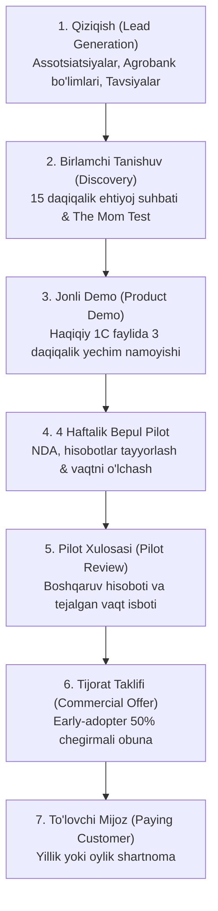

# AGROHISOB CFO — BOZORGA CHIQISH STRATEGIYASI (GO-TO-MARKET - GTM)

**Sana:** 2026-yil 9-noyabr  
**Fokus:** O'zbekiston agrar B2B segmentiga bosqichma-bosqich kirib borish

---

## 1. STRATEGIK SAVDO VORONKASI (SALES PIPELINE)

---

## 2. ASOSIY TARQATISH KANALLARI (DISTRIBUTION CHANNELS)

### 1-Kanal: Agrobank va AgroVentures Ekotizimi (Eng ustuvor)
- Agrobankning tuman filiallaridagi agromoliyalashtirish bo'limlari orqali kredit so'rab murojaat qilgan, lekin hisoboti yetarli bo'lmagan fermerlarga "AgroHisob CFO orqali tayyorgarlik ko'rish" tavsiyasini berish.
- Bu orqali CAC minimal darajaga tushadi ($50-$80).

### 2-Kanal: Buxgalteriya va Konsalting Tarmoqlari
- O'nlab fermer xo'jaliklarining buxgalteriyasini yurituvchi autsorsing buxgalterlar va auditorlarga "Buxgalter kabineti"ni bepul berish.
- Har bir buxgalter o'rtacha 5-10 ta fermer mijozini platformaga olib kiradi (ko'paytiruvchi effekt).

### 3-Kanal: O'zbekiston Meva-sabzavot Eksportyorlari Assotsiatsiyasi
- Eksportyorlar uchun sovutgich va aylanma kreditlar bo'yicha maxsus veb-seminarlar o'tkazish, PF-82 transport subsidiyalari kalkulyatorini namoyish etish.

### 4-Kanal: Agrosanoat Ko'rgazmalari (AgroWorld, UzAgroExpo)
- Yiliga 2 marta o'tkaziladigan yirik sanoat ko'rgazmalarida stend va amaliy FinTech master-klasslari bilan qatnashish.
