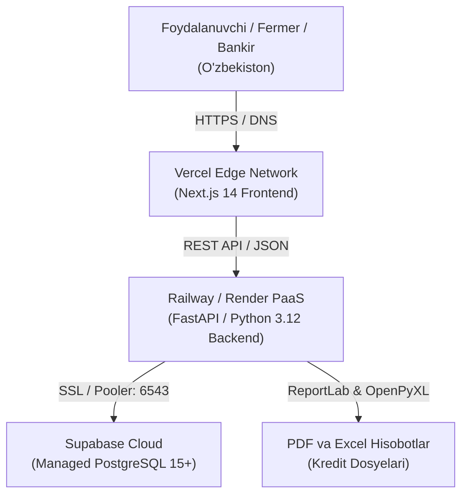

# AGROHISOB CFO — BULUTLI XOSTING VA INFRATUZILMA TANLOVI HUJJATI (HOSTING DECISION)

**Hujjat identifikatori:** `DOC-AH-HOST-01`  
**Sana:** 2026-11-09  
**Holat:** TASDIQLANGAN (APPROVED)  
**Tadqiqotchi guruh:** Cloud Infrastructure Architect, Senior DevOps, SRE  

---

## 1. STRATEGIK XULOSA VA MEZONLAR

AgroHisob CFO platformasi O'zbekiston agrobiznes korxonalari va bank mutaxassislari uchun xizmat qiluvchi B2B FinTech SaaS tizimidir. Infratuzilmani tanlashda quyidagi 5 ta asosiy mezon asos qilib olindi:

1. **Hisoblash aniqligi va tezligi:** FastAPI moliyaviy hisob-kitoblar mexanizmini kechikishlarsiz (low-latency) bajarish.
2. **Next.js 14 App Router to'liq qo'llab-quvvatlanishi:** Server-Side Rendering (SSR) va Server Components uchun optimal muhit.
3. **Ma'lumotlar xavfsizligi va PostgreSQL barqarorligi:** Tranzaksiyalar, kredit hisobotlari va fermer ma'lumotlarini ishonchli saqlash.
4. **DevOps xarajatlari va tezkorlik:** MVP va akselerator bosqichida ortiqcha infratuzilmaviy xarajatlarsiz (Zero-DevOps overhead) tezkor jonli namoyish qilish imkoniyati.
5. **O'zbekiston hududiy kirish qulayligi:** Toshkent va viloyatlardan veb-interfeysga tezkor yuklanish (CDN/Edge routing).

---

## 2. QIYOSIY TAHLIL VA YAKUNIY TANLOV

### A. Frontend Xostingi (Next.js 14 App Router)

| Platforma | Next.js 14 Mosligi | Global CDN / Edge | SSL & Deploy Tezligi | Tavsiya |
| :--- | :--- | :--- | :--- | :--- |
| **Vercel (Tanlangan)** | **100% Native (Yaratuvchisi)** | **Global Edge tarmog'i, Frankfurt/Toshkent kechikishi minimal** | **Avtomatik Let's Encrypt SSL, GitHub orqali 30 soniyada deploy** | **BIRINCHI TANLOV (TAVSIYA ETILADI)** |
| Netlify | Yaxshi, biroq ayrim SSR funksiyalari moslashuv talab qiladi | Yaxshi | Avtomatik | Zaxira |
| AWS S3 + CloudFront | Moslashuv juda murakkab (Server Components uchun Lambda@Edge kerak) | Yuqori | Qo'lda sozlanadi | MVP uchun tavsiya etilmaydi |

**Xulosa:** Frontend uchun **Vercel** tanlandi. Sababi: Next.js 14 App Router bilan to'liq uyg'unlik, nol konfiguratsiya, har bir Git push uchun Preview muhitlari va yuqori tezlik.

---

### B. Backend API Xostingi (FastAPI / Python 3.12)

| Platforma | Python 3.12 Mosligi | Doimiy Ishlash & Health Check | Sozlash Murakkabligi | Tavsiya |
| :--- | :--- | :--- | :--- | :--- |
| **Railway (Tanlangan)** | **To'liq qo'llab-quvvatlaydi, Dockerfile yoki Nixpacks** | **Avtomatik qayta ishga tushirish, Health Check integratsiyasi** | **Juda oson, GitHub orqali avtomatik build** | **BIRINCHI TANLOV (TAVSIYA ETILADI)** |
| **Render (Muqobil)** | To'liq qo'llab-quvvatlaydi | Bepul rejimda uxlash (sleep) mavjud, pullikda barqaror | Oson | **ZAXIRA TANLOV** |
| Fly.io | Docker konteynerlar orqali ishlaydi | Yuqori | O'rta darajada murakkab | Texnik guruhlar uchun mos |
| AWS ECS / EKS | Korporativ, yuqori masshtab | Yuqori | Juda yuqori (DevOps talab qiladi) | Katta korporativ bosqichda |

**Xulosa:** Backend API uchun **Railway** (yoki **Render**) tanlandi. Sababi: Python 3.12, Uvicorn va FastAPI uchun tezkor deploy, o'rnatilgan sirlar (secrets) menejmenti va doimiy monitoring.

---

### C. Ma'lumotlar Bazasi (Managed PostgreSQL)

| Platforma | PostgreSQL Versiyasi | Connection Pooling | Zaxira Nusxalash (Backups) | Tavsiya |
| :--- | :--- | :--- | :--- | :--- |
| **Supabase (Tanlangan)** | **PostgreSQL 15+** | **Supavisor / pgBouncer o'rnatilgan** | **Kunlik avtomatlashtirilgan zaxira** | **BIRINCHI TANLOV (TAVSIYA ETILADI)** |
| Neon Serverless | PostgreSQL 16+ | Connection Pooling mavjud | On-demand | Muqobil serverless |
| AWS RDS PostgreSQL | PostgreSQL 15/16 | Qo'shimcha RDS Proxy kerak | Avtomatlashtirilgan | Enterprise bosqichda |

**Xulosa:** Ma'lumotlar bazasi uchun **Supabase PostgreSQL** tanlandi. Sababi: SQLAlchemy 2.0 bilan mukammal ishlaydi, barqaror pooling mexanizmiga ega, ma'lumotlar xavfsizligi va kelgusida fayl saqlash (Storage) imkoniyatini taqdim etadi.

---

## 3. ARXITEKTURA VA OQIM MATRITSASI

---

## 4. XARAJATLAR BAHOSI (MVP VA BOSHLANG'ICH BOSQICH)

- **Vercel Hobby Tier:** $0 / oy (Keng polosali internet, SSL, avtomatik deploy).
- **Railway Starter / Render Individual:** $5 / oy (Doimiy ishlovchi 512MB-1GB RAM FastAPI konteyneri).
- **Supabase Free Tier:** $0 / oy (500MB PostgreSQL ma'lumotlar bazasi, 50,000 oylik so'rovlar).
- **Jami infratuzilma xarajati:** ~$5 / oy (MVP va akselerator namoyishi bosqichi uchun eng tejamkor va ishonchli yechim).
