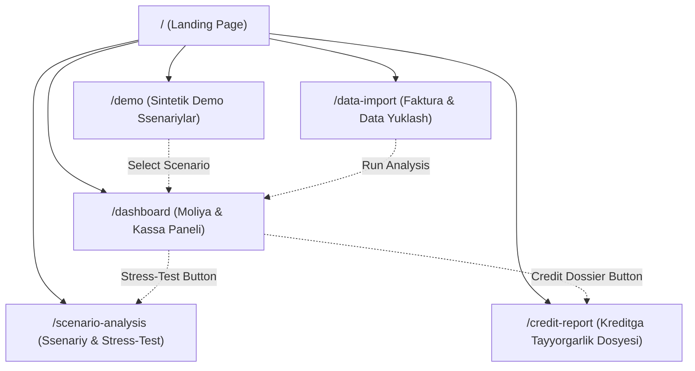

# AgroHisob CFO — Information Architecture & UI Hierarchy

**Document Reference:** `docs/INFORMATION_ARCHITECTURE.md`  
**Author:** UI/UX Product Designer & Principal Software Architect  
**Platform:** Next.js 14 App Router

---

## 1. Application Sitemap & Routing Hierarchy

AgroHisob CFO adopts a focused, 6-screen application architecture designed for clarity and rapid financial insight.

---

## 2. Screen Specifications & Content Inventory

### Screen 1: Landing Page (`/`)
* **Purpose**: Establish trust, present the core value proposition, and introduce the systemic agricultural financial dilemma in Uzbekistan.
* **Key Components**:
  - Global Header & Uzbekistan Context Banner
  - Hero Value Proposition & Dual CTAs (*"Demoni sinab ko‘rish"*, *"Jonli Moliya Paneliga O'tish"*)
  - Macroeconomic Statistics Grid (*91,775+ farmers, 56.2 trln UZS Agrobank lending plan, 19 bankrupt clusters*)
  - Problem Statement Triad (*Cash-flow gaps, Collateral shortages, Dossier friction*)
  - Feature Architecture Cards
  - Primary Conversion Banner

### Screen 2: Demo Selector (`/demo`)
* **Purpose**: Enable users to choose between 3 distinct, pre-calibrated agribusiness profiles.
* **Key Components**:
  - Synthetic Data Disclaimer Banner
  - 3 Interactive Scenario Cards:
    1. *Andijon Baraka Fermer Xo'jaligi* (Small Farmer, 65 ha)
    2. *«Samarqand Agro Eksport» MChJ* (Exporter, 120 ha)
    3. *«Qashqadaryo Paxta-G'alla Klasteri»* (Cluster, 2,500 ha)
  - Profile Metadata Grid (Land area, main crop, opening cash, existing debt load, seasonal dynamic)
  - Direct Action Buttons (*Dashboard, Stress-Test, Credit Dossier*)

### Screen 3: Financial Dashboard (`/dashboard`)
* **Purpose**: Core vertical slice displaying calculated financial performance, monthly liquidity, and DSCR covenants.
* **Key Components**:
  - Quick Scenario Switcher Tabs
  - Mathematical Reconciliation Indicator (*100% Reconciled*)
  - 6 Financial KPI Cards:
    1. Boshlang'ich Kassa (Opening Balance)
    2. Yillik Yalpi Tushum (Total Annual Inflows)
    3. Yillik Jami Xarajat (Total Annual Outflows)
    4. Yakuniy Kassa Qoldig'i (Closing Cash Balance)
    5. Qarz Qoplami (Annual DSCR & Underwriting Rating)
    6. Kassa Uzilishi (Deficit Months Count & Lowest Cash Point)
  - Responsive Composed Cash-Flow Chart (Recharts)
  - 12-Month Detailed Ledger Table
  - Categorized Expense Distribution (MXIK/IKPU Aggregations)

### Screen 4: Smart Data Ingestion (`/data-import`)
* **Purpose**: Prepare data upload workflows for future real E-faktura and bank statement ingestion.
* **Key Components**:
  - Uzbekistan Law O‘RQ-547 Compliance Notice
  - Zero-Retention Mode Toggle (in-memory parsing)
  - 3 Upload Tabs (*Soliq E-Faktura, Bank Statement, Cadastre Data*)
  - Drag-and-drop file dropzone
  - Smart MXIK Classification Preview Table showing sample parsed rows with IKPU codes

### Screen 5: Scenario & Stress-Test Simulator (`/scenario-analysis`)
* **Purpose**: Allow finance managers to model biological shocks and price changes against debt service obligations.
* **Key Components**:
  - Interactive Sliders:
    - Hosildorlik Shoki (*Yield Shock: -40% to +40%*)
    - Mahsulot Narxi Tebranishi (*Price Volatility: -40% to +40%*)
    - Xarajatlar Inflyatsiyasi (*Input Cost Shock: 0% to +50%*)
    - Kredit Foiz Stavkasi (*Interest Rate: 10% to 28%*)
  - Solvency Status Alert (*Resilient, Vulnerable, Insolvent*)
  - Baseline vs Stressed Comparative Metric Cards
  - Stressed 12-Month Cash-Flow Composed Chart

### Screen 6: Credit Readiness Report (`/credit-report`)
* **Purpose**: Provide a bank-ready pre-underwriting scorecard conforming to Agrobank credit committee expectations.
* **Key Components**:
  - Company Legal & Agronomic Profile (Area, Bonitet Score, Cadastre)
  - Overall Agro-Credit Score (0–100) & Rating Tier (*Tier 1 (A-Klass)*)
  - 3 Core Underwriting Indicators:
    - Debt Service Coverage Ratio (DSCR)
    - Maximum Safe Additional Borrowing Capacity (UZS)
    - Cabinet of Ministers Res. 613 (VMQ-613) Land Lease Collateral Value (65% LTV)
  - Identified Strengths & Agronomic Risk Factors
  - Credit Committee Analytical Recommendation Note
  - Statutory Legal Disclaimer

---

## 3. UI Component Architecture & Design System Tokens

### 3.1 Design Tokens (Tailwind Palette)
* **Agro Green Primary**: `#16a34a` (Brand primary, positive cash flows, agriculture identity)
* **Agro Green Dark**: `#14532d` (Header banners, institutional branding)
* **Navy Slate**: `#0f172a` / `#020617` (Body text, contrast surfaces)
* **Rose Warning**: `#f43f5e` (Cash outflows, deficit months, critical risks)
* **Sky Blue**: `#0284c7` (Closing cash balance line, neutral analytics)
* **Warm Amber**: `#d97706` (Watchlist DSCR, synthetic benchmark disclaimers)

### 3.2 Typography & Spacing
* **Font Family**: Inter, -apple-system, BlinkMacSystemFont, "Segoe UI", Roboto
* **Scale**: Clear financial hierarchy (`text-xs` for labels/metadata, `text-sm` for table content, `text-base` for descriptions, `text-2xl`–`text-4xl` for monetary KPIs)
* **Layout Grid**: 12-column responsive grid with consistent 16px/24px gutters.
