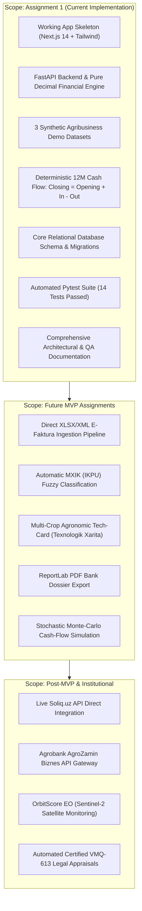

# AgroHisob CFO — Product Requirements Document (PRD)

**Document Reference:** `docs/PRODUCT_REQUIREMENTS.md`  
**Status:** Approved for Assignment 1  
**Author:** Technical Product Manager & Financial Systems Specialist  
**Target Market:** Republic of Uzbekistan (AgriFinTech / B2B SaaS)

---

## 1. Product Vision

### 1.1 The Agricultural Financial Problem in Uzbekistan
Uzbekistan’s agricultural sector accounts for 16.6%–20% of GDP (~$24.3B in 2025) and employs millions across 91,775 commercial farms, 633 clusters, and 34,283 agro-SMEs (*Stat.uz / CERR*). Despite state financing mechanisms (12.4 trln UZS allocated via the Agricultural Fund) and commercial bank lending targets (56.2 trln UZS planned by ATB «Agrobank» in 2026), agricultural enterprises suffer from severe structural financial challenges:
1. **Retrospective Bookkeeping Only**: Enterprise accounting software (e.g., 1C, Soliq.uz) records transactions purely for past tax accounting. It cannot model future seasonal cash flows tied to biological crop schedules.
2. **Seasonal Liquidity Gaps (*Kassa Uzilishi*)**: Agronomic input costs (seeds, mineral fertilizer, diesel fuel, seasonal labor) peak heavily during spring planting (March–May), while sales revenue is realized 4–6 months later at harvest. Between 2022 and 2025, 19 cotton and textile clusters collapsed into insolvency because they could not anticipate or finance their seasonal cash gaps (*Lex.uz - PF-103*).
3. **Severe Collateral Bottlenecks**: Over 57% of agricultural loan collateral is locked in urban real estate (*Agrobank Investor Call, 2025*). Although Cabinet of Ministers Resolution No. 613 (VMQ-613) permits pledging agricultural land lease rights (*yer ijarasi huquqi*), banks and appraisers lack automated software to compute the Discounted Cash Flow (DCF) market value of land lease rights.
4. **Frictional Credit Origination**: Preparing a standard bank loan dossier or subsidy application currently forces agribusinesses to spend $500–$3,000 on consulting firms and wait 3–6 weeks.

### 1.2 Product Purpose & Core Value Proposition
**AgroHisob CFO** is an institutional B2B AgriFinTech financial intelligence platform. It converts electronic tax invoices (Soliq E-faktura) and bank statement data into:
- 12-month forward-looking seasonal cash-flow projections;
- Debt Service Coverage Ratio (DSCR) underwriting assessments;
- Automated VMQ-613 land lease collateral DCF estimations;
- Standardized, bank-ready credit dossiers in under 3 minutes.

### 1.3 Differentiation from Ordinary Bookkeeping
Unlike 1C or general accounting systems:
- It connects **agronomic seasonality** (crop calendars, planting vs harvest cycles) to **financial liquidity**.
- It provides **deterministic forward cash forecasting** rather than retrospective ledger entries.
- It calculates **bank underwriting ratios** (DSCR, safe debt capacity) tailored to Uzbekistan commercial bank policies.
- It models **regulatory land lease collateral valuation** under Uzbekistan Resolution VMQ-613.

### 1.4 Measurable Customer Outcomes
* **Dossier Preparation Time**: Reduced from 14 days to under 30 minutes.
* **Consulting Expense**: Reduced from $1,500+ down to a $29–$99/month SaaS subscription.
* **Early Deficit Visibility**: Anticipates seasonal cash shortages 90–120 days in advance, allowing timely pre-arranged working capital credit.

---

## 2. User Personas

### Persona A: Farm Owner (*Fermer Xo'jaligi Rahbari*)
* **Profile**: Shokir aka, 48 years old, head of a 65-hectare commercial farm in Asaka, Andijon.
* **Responsibilities**: Overseeing planting, managing field workers, purchasing diesel and fertilizer, negotiating crop sale prices.
* **Financial Knowledge**: Practical business understanding; knows operating costs and harvest targets, but finds formal accounting statements and bank ratio formulas complex.
* **Pain Points**: Runs out of cash in April and May when purchasing fertilizer and diesel; struggles to explain to the bank why his business will be liquid in October.
* **Goals**: Obtain clear, simple visibility into when cash runs low and generate an Agrobank-ready loan request without hiring external consultants.
* **Permission Level**: `Owner` (Full access to farm data, view-only on system configurations).

### Persona B: Agribusiness Chief Accountant (*Bosh Buxgalter*)
* **Profile**: Nilufar opa, 42 years old, chief accountant at an agricultural export company in Urgut, Samarqand.
* **Responsibilities**: Filing monthly Soliq E-faktura returns, tracking bank statements, reconciling accounts payable to cold storage suppliers and transport companies.
* **Financial Knowledge**: Deep expertise in national accounting standards (BHMS/NAS) and Soliq tax portals, but lacks time to build 12-month financial forecasting models in Excel.
* **Pain Points**: Manually re-entering thousands of invoice rows into custom spreadsheets whenever the bank requests cash-flow projections.
* **Goals**: Upload Soliq.uz invoice spreadsheets (XLSX) and bank statements (CSV) and have them classified automatically into agronomic cost buckets.
* **Permission Level**: `Accountant` (Data import, transaction verification, journal review).

### Persona C: Finance Director / CFO (*Moliya Direktori*)
* **Profile**: Jamshid, 36 years old, Finance Director at an integrated cotton-wheat cluster in Qashqadaryo (2,500 ha).
* **Responsibilities**: Capital allocation, debt service management across syndicated loans, managing liquidity for hundreds of contracted farmers, budgeting fuel and machinery leases.
* **Financial Knowledge**: Advanced corporate finance, DSCR analysis, sensitivity modeling, working capital optimization.
* **Pain Points**: Inability to stress-test harvest yields and price drops quickly against fixed monthly debt service obligations.
* **Goals**: Real-time sensitivity simulation (±20% yield/price shock) and consolidated monthly cash-flow monitoring across enterprise units.
* **Permission Level**: `Finance_Manager` / `Admin` (Scenario modeling, credit limit calculation, report generation).

### Persona D: Commercial Bank Credit Analyst (*Kredit Bo'limi Mutaxassisi*)
* **Profile**: Bobur, 29 years old, senior SME credit underwriting specialist at ATB «Agrobank».
* **Responsibilities**: Evaluating agricultural loan applications ($50,000 to $2,000,000), verifying debt repayment capacity, checking collateral adequacy.
* **Financial Knowledge**: Expert in credit risk, balance sheets, and Central Bank prudential standards.
* **Pain Points**: Farm financial statements are frequently non-standardized, paper-heavy, and unverified, requiring 8–12 hours of manual rework per file.
* **Goals**: Receive a standardized, transparent credit dossier where cash-flow projections reconcile to primary documents and land collateral conforms to VMQ-613.
* **Permission Level**: `Auditor` / `Bank_Reviewer` (Read-only access to finalized pre-underwriting dossiers).

---

## 3. Product Scope & Boundaries

### 3.1 In-Scope for Assignment 1 (Mandatory)
* Fully runnable Next.js 14 frontend and FastAPI backend.
* 3 synthetic demo agribusiness scenarios (Small farmer, Exporter, Cluster).
* End-to-end working vertical slice: select business $\rightarrow$ compute cash flows $\rightarrow$ render KPI cards and composed chart.
* Real mathematical cash flow calculation (no hardcoded numbers in UI).
* Normalized PostgreSQL schema and SQLite local fallback.
* Automated foundation test suite with 100% pass rate.

### 3.2 Out-of-Scope for Assignment 1 (Strict Boundaries)
* Direct integration with production bank APIs (Agrobank IABS) or Soliq.uz live servers.
* Live parsing of user-uploaded binary Excel files (UI and ingestion preview provided; engine consumes synthetic models in V1).
* Satellite Earth Observation (Sentinel-2 NDVI) imagery feeds.
* Autonomous legal certification of collateral (must remain decision-support pre-valuation).
* External commercial LLM API integrations (preserves financial confidentiality).

---

## 4. User Stories

| ID | Persona | User Story | Priority | Preconditions | Acceptance Criteria | Error Handling |
| :--- | :--- | :--- | :--- | :--- | :--- | :--- |
| **US-01** | Farm Owner | *As a Farm Owner, I want to select a pre-configured synthetic profile resembling my farm, so that I can immediately evaluate my seasonal cash flow without entering hundreds of manual numbers.* | P0 | Backend running, demo dataset seeded | UI renders scenario cards; selecting loads 12M cash flow into dashboard within 500ms. | If scenario ID is invalid, display 404 alert in Uzbek and fall back to default scenario. |
| **US-02** | Accountant | *As an Accountant, I want to see every month's opening balance, cash receipts, payments, and closing balance, so that I can verify the mathematical reconciliation of our cash accounts.* | P0 | Scenario selected | Dashboard table displays 12 rows where $\text{Closing} = \text{Opening} + \text{In} - \text{Out}$ and $\text{Opening}_{t+1} = \text{Closing}_t$. | If mathematical discrepancy $>0.01$, display prominent reconciliation error warning. |
| **US-03** | CFO | *As a CFO, I want to view our Debt Service Coverage Ratio (DSCR), so that I know whether our operating cash flow safely satisfies bank loan covenants.* | P0 | Debt schedule exists in scenario | Dashboard calculates annual DSCR; displays color-coded rating badge (*A'lo*, *Barqaror*, *Kuzatuvda*, *Kritik*). | If debt service is zero, display ratio as debt-free ($99.99\text{x}$) without division by zero. |
| **US-04** | CFO | *As a CFO, I want to simulate a 20% drop in crop yield or market prices, so that I can stress-test our solvency before committing to a bank loan.* | P1 | Scenario loaded | Moving slider recalculates stressed cash inflows, new DSCR, and count of deficit months dynamically. | Slider constraints enforce bounds ($-50\%$ to $+50\%$); invalid values reject with HTTP 422. |
| **US-05** | Credit Analyst | *As a Credit Analyst, I want to review an automated VMQ-613 land lease DCF collateral estimate, so that I can assess credit risk without waiting 2 weeks for a manual appraisal.* | P1 | Land area and bonitet score present | Report calculates discounted leasehold value and 65% bankable collateral amount based on VMQ-613 formula. | If land hectares $\le 0$, return validation error. |

---

## 5. Functional Requirements

* **FR-01: Scenario Selection**: The system shall provide an interactive selector for at least 3 distinct agribusiness types (*Small Farmer*, *Exporter*, *Cluster*).
* **FR-02: Deterministic Calculation**: The backend shall compute 12 monthly periods using exact Decimal arithmetic, strictly upholding:
  $$\text{Closing Balance}_t = \text{Opening Balance}_t + \text{Total Inflows}_t - \text{Total Outflows}_t$$
* **FR-03: Roll-Forward Integrity**: The opening balance of month $t+1$ shall equal the closing balance of month $t$.
* **FR-04: Dynamic Charting**: The frontend shall render a responsive composed chart displaying monthly Inflows (green bars), Outflows (red bars), and Closing Balance (blue line).
* **FR-05: Deficit Highlighting**: Months where the closing cash balance drops below zero shall be visually flagged as liquidity deficits (*Kassa Uzilishi*).
* **FR-06: Error Responses**: API endpoints shall return standard RFC 7807 problem details with human-readable error explanations in Uzbek.

---

## 6. Non-Functional Requirements

* **NFR-01: Performance**: The financial calculation endpoint (`/api/v1/demo/organizations/{id}/cashflow`) shall respond in $< 100\text{ ms}$ for a 12-month transaction set.
* **NFR-02: Precision**: Financial arithmetic shall utilize Python `Decimal` with rounding to 2 decimal places to avoid IEEE 754 binary floating-point errors.
* **NFR-03: Security & Privacy**: No confidential customer financial records or credentials shall be logged or exposed to third-party AI APIs. Law O‘RQ-547 compliance shall be upheld.
* **NFR-04: Responsiveness**: The user interface shall provide clean, unbroken layouts across mobile ($375\text{px}$), tablet ($768\text{px}$), and desktop ($1280\text{px}+$) viewports.
* **NFR-05: Maintainability**: Clear separation of concerns between presentation (Next.js), routing, business logic, and database persistence.
