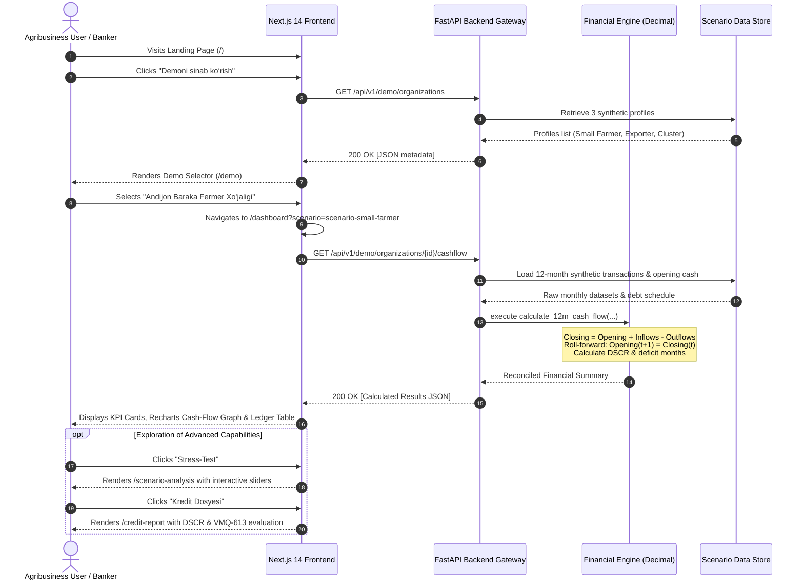
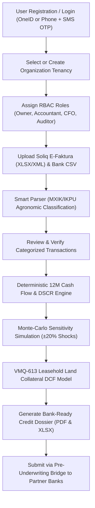
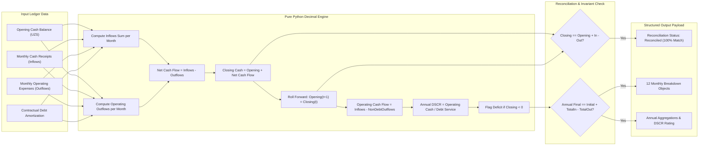
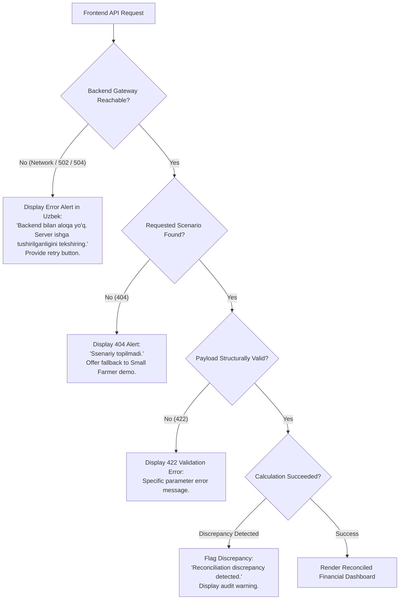

# AgroHisob CFO — User Flows & Operational Journeys

**Document Reference:** `docs/USER_FLOWS.md`  
**Author:** UI/UX Product Designer & Systems QA Specialist  
**Language:** English (Technical Documentation)

---

## 1. Primary User Journey (Unauthenticated Demo Flow)

The primary goal of Assignment 1 is to allow any agricultural founder, bank loan officer, or prospective client to explore AgroHisob CFO immediately without friction.

---

## 2. Future Authenticated Enterprise User Journey

In subsequent phases (Assignments 2–3), enterprise users will authenticate, create organization tenancies, upload live Soliq E-faktura files, and manage team access.

---

## 3. Financial Data Processing Pipeline

---

## 4. Error Scenarios & Defensive Fallback Matrix

AgroHisob CFO enforces a strict rule: **Never silently substitute fake successful data when a backend request fails.**

### Detailed Failure Handling Table:

| Error Case | Trigger Condition | Backend HTTP Status | Frontend User Experience |
| :--- | :--- | :--- | :--- |
| **Backend Offline** | FastAPI server stopped or network cut off | Network Error (Failed to fetch) | Displays clear red alert: *"Backend bilan aloqa o'rnatilmadi. Iltimos FastAPI serveri ishlayotganligini tekshiring."* |
| **Invalid Scenario ID** | User enters `/dashboard?scenario=unknown-id` | `404 Not Found` | Renders clear error message with available scenario links. |
| **Malformed Parameter** | Negative initial balance or shock $>50\%$ | `422 Unprocessable Entity` | Form highlights the specific field with boundary constraints. |
| **Reconciliation Discrepancy** | Inflows/outflows don't equal closing balance | `200 OK` (flagged in payload) | Prominently displays *"Reconciliation discrepancy detected"* banner in red. |
| **Zero Debt Organization** | Farm has zero loans | `200 OK` | DSCR shows *"Qarzsiz (99.99x)"* without dividing by zero. |
| **Loading Latency** | Network delay during heavy calculations | Pending Promise | Shows animated spinner with text *"FastAPI Moliyaviy Yadrosida 12 Oylik Balans Hisoblanmoqda..."* |
